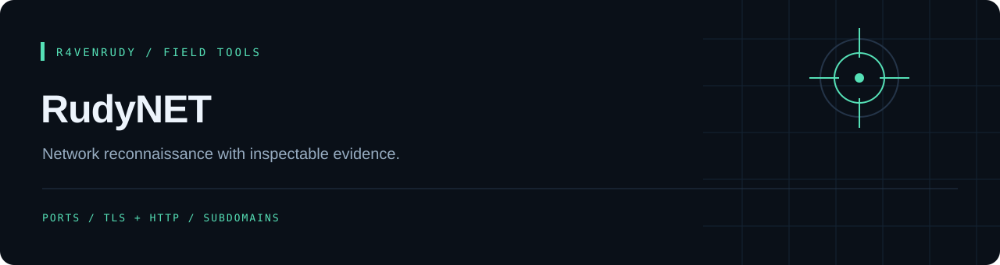

<p align="center"></p>

<p align="center">
  
  
  <a href="LICENSE"></a>
</p>

<p align="center"><strong>Network reconnaissance with inspectable evidence.</strong></p>

<p align="center"><a href="#overview">Overview</a> · <a href="#capabilities">Capabilities</a> · <a href="#quick-start">Quick start</a> · <a href="#implementation-notes">Implementation notes</a></p>

---

## Overview

A modular command-line toolkit for TCP/UDP port checks, banner observations, HTTP/TLS inspection and DNS-based subdomain discovery. Implemented commands return terminal output with optional JSON, CSV or text exports.

## Capabilities

| Command | Implemented behavior |
| :--- | :--- |
| `scan` | TCP connect checks, selected UDP probes and optional banner reads |
| `web` | Certificate inspection, HTTP security-header heuristics and cookie observations |
| `subdomain` | Wordlist-based DNS resolution, wildcard filtering, CNAME observations and optional crt.sh discovery |

## Quick start

Requires Python and the packages listed in `requirements.txt`. Keep the bundled `raven.png`; the CLI validates it during startup.

```bash
git clone https://github.com/r4venrudy/RudyNET.git
cd RudyNET
python -m pip install -r requirements.txt
python rudynet.py --help
```

Examples for a local lab or a domain you administer:

```bash
python rudynet.py scan --target 127.0.0.1 --ports 80,443 --banner
python rudynet.py web --url https://example.com --output json --file web.json
python rudynet.py subdomain --domain example.com --crtsh --output json --file subdomains.json
python -m unittest discover -s tests -v
```

## Options

| Command | Option | Default | Meaning |
| :--- | :--- | :--- | :--- |
| `scan` | `-p, --ports` | `1-1000` | Range (`20-25`), list (`80,443`) or a mix (`22,80-90`); duplicates are dropped |
| `scan` | `-s, --scan-type` | `tcp` | `tcp`, `udp` or `both` |
| `scan` | `-T, --timeout` | `1.0` | Seconds per connection |
| `scan` | `--banner` | off | Read service greetings, HTTP `HEAD` for silent ports |
| `scan` | `-w, --workers` | `200` | Parallel connections (1-1000); lower it for fragile hosts or slow links |
| `web` | `--ssl-only` | off | Only inspect the TLS certificate |
| `web` | `-T, --timeout` | `10.0` | Seconds per request |
| `subdomain` | `-d, --domain` | required | A domain or a URL; the scheme, port and path are stripped |
| `subdomain` | `-w, --wordlist` | bundled list | One label per line, `#` comments allowed |
| `subdomain` | `-t, --threads` | `50` | Parallel DNS lookups |
| `subdomain` | `-T, --timeout` | `3.0` | DNS timeout per name |
| `subdomain` | `--crtsh` | off | Add names from certificate-transparency logs |
| all | `-o, --output` / `-f, --file` | none | `json`, `csv` or `txt`; with only `-f`, the extension picks the format (JSON if unrecognized) |

## Implementation notes

- The entry point is `rudynet.py`; `rudysec.py` is kept as an alias that runs the same CLI.
- UDP timeouts are ambiguous and are omitted from positive results; a lack of response does not establish that a port is closed. IPv6 targets (for example `::1`) work too; a host with both address types is scanned over IPv4.
- Header grading follows browser behavior: HSTS earns nothing when the final page is plain HTTP, a comma list in `Referrer-Policy` is graded by its last value, and a header sent twice with the same value (common behind proxies) is accepted.
- Web grades are hardening heuristics. TLS metadata is inspected for the input host, while HTTP requests can follow redirects to another host; assess the final target independently when needed.
- Subdomain discovery generates DNS queries and port checks initiate network connections. Scope targets explicitly and use only systems you own or are authorized to assess.

## Project map

```text
rudynet.py                 Main Click CLI
modules/port_scanner.py    TCP/UDP checks and banners
modules/web_security.py    TLS and HTTP heuristics
modules/subdomain_enum.py  DNS and certificate-transparency discovery
data/subdomains.txt        Default wordlist
utils/                     Colors and JSON/CSV/TXT export
tests/                     Unit tests
```

## GitHub package

The non-root CLI image is built and unit-tested before publication.

```sh
docker run --rm ghcr.io/r4venrudy/rudynet:latest --help
docker run --rm ghcr.io/r4venrudy/rudynet:latest web --url https://example.com
```

Use only authorized targets. Docker's network namespace applies to port scans; container loopback is the container itself. Bind-mount a writable directory at `/data` and choose an absolute output path there when exporting reports. Linux users may pass `--user "$(id -u):$(id -g)"` for a bind mount they own.

Images use `latest` and `sha-<full commit SHA>` tags. This package includes the implemented `scan`, `web`, and `subdomain` commands; it does not add the missing packet-monitor module.


## License

[MIT](LICENSE). Preserve the attribution in the license file.

---

<p align="center">Part of the <a href="https://github.com/r4venrudy">r4venrudy</a> project collection.</p>
